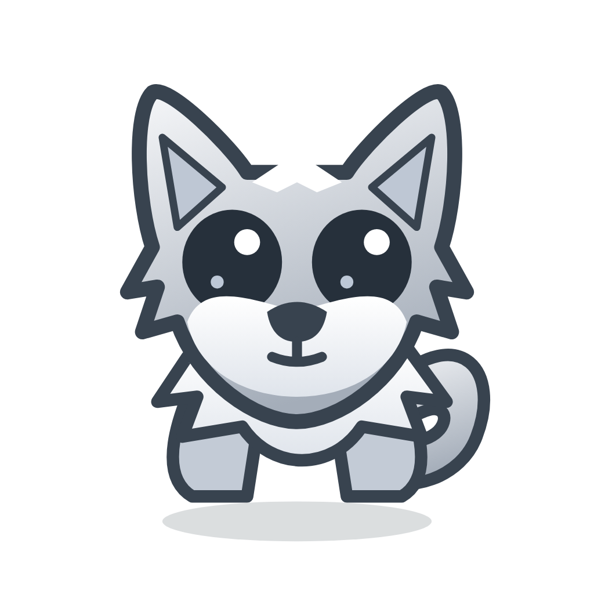

# Woof

**Your AI lookout.** A desktop direwolf companion for Hermes Agent.



Woof lives on your Mac while Hermes can run on another machine. It brings new replies and task results to your desktop, and offers contextual follow-ups you can choose to send back to Hermes. It is a companion, not a Hermes fork or an autonomous action engine.

**Current version: 0.3.7 · macOS Apple silicon · Private development repository**

## Start here

- [Documentation home](docs/index.md)
- [Download the current private release](https://github.com/raiph-ai/woof/releases/tag/v0.3.7)
- [Installation and pairing](docs/setup.md)
- [How it works](docs/architecture.md)
- [User guide](docs/usage.md)
- [Troubleshooting](docs/troubleshooting.md)
- [Developer guide](docs/development.md)
- [Security and privacy](docs/security.md)
- [Roadmap and release history](docs/roadmap.md)
- [Detailed bridge/API reference](README-backend.md)

The repository and release assets are private. **GitHub Pages is not enabled.** Documentation is rendered inside the repository; public hosting and a domain are separate future decisions.

## What it does

- Small draggable white/grey wolf with unread badge, tail-wag and round-mouth notification reaction.
- Three panels: **Notifications**, **Proactive**, and **Ideas for you**.
- New user-visible final Hermes replies from the connected profile, durable task results, and configurable scheduled-event sources.
- First-launch inbox cutoff and durable deduplication; no bulk backfill of old assistant messages.
- **Wolf bark**, **Little howl**, or **None**, with preview. Bark uses the uploaded recording decoded to WAV, not the old synthesized tone.
- Contextual model reflection only when requested; suggestions never execute without a click.
- Real Hermes scheduling/request integration, without changing Hermes core or starting its scheduler.
- Configurable server URL, session-only pairing by default, and optional Keychain-backed persistence.
- Readable light/dark presentation, 85% default background opacity, card dismissal, acknowledge-all, panel reorder, and counters.
- Immediate first display of already-received notifications, followed by normal fresh polling; hidden panel renderer released after 30 seconds.

## Two-part setup

**Client Mac:** open `Woof-0.3.7-arm64.dmg` and drag Woof into Applications. The packaged client needs no Python, Node, or Hermes. Quit an older client before replacing it. This build is ad-hoc signed, **not Apple-notarized**.

**Hermes host:** obtain this source and run the bridge beside an existing Hermes installation:

```sh
python3 -B backend.py --profile your-profile
```

Python 3.9+ is required; no extra Python packages. Omit `--profile` for the default profile. The default bridge listener is `http://127.0.0.1:47831`. Pair using its URL and securely retrieved token. The bridge prints the token's path, not its value.

For a remote host, prefer an SSH tunnel or trusted HTTPS. Direct LAN HTTP is an explicit unencrypted exception, not a public deployment recommendation. Follow the [setup guide](docs/setup.md), not a copied machine-specific address.

## Develop

```sh
npm ci
npx playwright install chromium
npm test
python3 -B -m unittest test_backend -v
node test-ui.cjs
npm start
```

See the [developer guide](docs/development.md) for native tests, sound/source verification, packaging, signing, installer checks, and release steps. Portable GitHub Actions checks do not substitute for native Mac verification.

## Safety and current limits

Tokens authorize context access and agent requests. Protect them like passwords. The client loads bundled UI, keeps credentials out of restored renderer configuration, and has no plaintext credential-persistence fallback. The bridge authenticates reads/writes, checks Host/Origin, reads Hermes history without mutating it, and retains normal approval boundaries. No telemetry or automatic paid analysis loop is introduced.

Single connected profile; no multi-tenant roles. Native client verified on macOS arm64. Background detection uses polling, not instant push. Keychain can require interactive authorization. Developer ID signing, notarization, and wider desktop-platform validation remain future work. Electron is still the main size/RAM baseline.

## License and public-release gate

Code and original mascot artwork are MIT-licensed. The bark is user-provided audio; confirm redistribution rights before a public release. The howl is an original synthesized effect. This private repository does not claim public launch readiness.

Contributions: [CONTRIBUTING.md](CONTRIBUTING.md). Private vulnerability reports: [SECURITY.md](SECURITY.md).

Inspired by Hark's panels/action buttons; not affiliated with Hark, Goldfish, or Nous Research.
